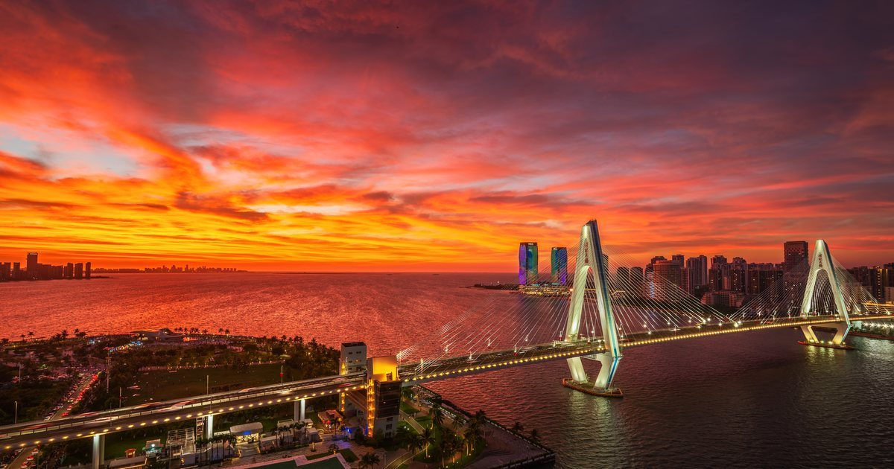

# 18N-MSPA · 北纬18度椰青摄联



海南省北纬18度椰青摄影联盟（18° North – Hainan Mass Student / Senior Photographers Association）的官方网站。

纯静态站点：HTML + CSS + 原生 JavaScript，没有构建步骤，没有后端。下载文件夹、双击 `index.html` 就能跑。

**线上地址**：https://hainan-n-mspa.pages.dev

## 发布流程

```
本地文件夹 → push 到 GitHub → Cloudflare Pages 自动拉取构建 → 上线
```

推到 GitHub 后 1～2 分钟自动生效，**不需要手动打包或上传**。

- Cloudflare Pages 的构建配置：无构建命令，输出目录为仓库根目录（纯静态）
- `_headers` 负责缓存头（图片 7 天、静态资源 1 天），**不要删**
- 404 页面由根目录的 `404.html` 提供
- **照片原图不要进仓库**：`.gitignore` 已排除 `raw/`、`rawcn/`、`椰青/` 及 RAW/PSD 格式，
  仓库里只放压缩后的图（长边 ≤1800px）和 `images/thumbs/` 缩略图（长边 800px）

## 功能

- **首页 / 关于 / 成员 / 加入我们** — 社团介绍、成员名录、入群与投稿指南
- **作品集** — 瀑布流作品墙，按分类筛选，点击看大图（灯箱）；图片走缩略图，原图另开
- **霞光预报** — 全站最有意思的部分
  - 25 个海南机位（海口 10 个，按朝向细分到东向朝霞 / 西向晚霞）
  - 覆盖 **今天·明天 × 日出·日落** 四个时段，切换不重新请求
  - 评分：高云 × 低云 × 中云 × AOD × 降水 的乘法结构，再整体压缩；按太阳方位角判断机位朝向是否对得上
  - 数据来自 [Open-Meteo](https://open-meteo.com/)（免费、无需 Key）

## 快速开始

```bash
# 任意静态服务器都行，例如：
python3 -m http.server 8000
# 然后打开 http://localhost:8000
```

霞光预报页需要联网取数；本地用 `file://` 直接打开时浏览器会因跨域限制取不到数据，用上面的服务器方式即可。

## 目录结构

```
.
├── index.html / about.html / gallery.html / forecast.html / members.html / join.html
├── 404.html                  # 自定义错误页
├── assets/
│   ├── style.css             # 全站样式（深炭灰 + 磨砂玻璃 + 银色渐变）
│   ├── main.js               # 导航、滚动淡入、作品墙、灯箱
│   ├── photos.js             # 作品清单：加图/改分类/加署名都改这里
│   ├── forecast.js           # 霞光预报：机位库 SPOTS 和评分算法
│   └── logo-mark.svg
├── images/                   # 压缩后的照片（长边 ≤1800px）
│   └── thumbs/               # 作品墙用缩略图（长边 800px）
├── tools/                    # 辅助脚本（图片压缩、图标生成）
├── robots.txt / sitemap.xml / _headers
└── LICENSE
```

## 预报数据缓存

`data/forecast.json` 由 GitHub Actions 定时生成（每 4 小时一次，见 `.github/workflows/forecast-cache.yml`），
页面优先读这个静态文件，读不到或超过 14 小时才回退到 Open-Meteo 实时请求。

手动生成：`node tools/build-cache.mjs`

## 成员页

成员数据在 `assets/members.js`：`group` 区分 `core`（小组成员）与 `community`（交流群成员），
`titles` 是头衔。作品通过 `assets/photos.js` 的 `a` 字段（作者名）自动关联到成员卡。

每个成员可以生成一张 1080×1350 的名片（名字 + 头衔 + 作品 + 个人主页二维码 + 公众号二维码），
由 `assets/qrcode.js`（Kazuhiko Arase, MIT）在浏览器本地生成，不需要后端。

## 添加作品

1. 把照片放进 `images/`，跑一次 `tools/optimize-images.ps1`（Windows 下双击 `3-压缩新图片.bat`）压缩并生成缩略图
2. 在 `assets/photos.js` 里加一行：

```js
{ f: "文件名.jpg", t: "标题", c: "海岸风光", a: "作者" },
```

`c` 只能是 `海岸风光` / `城市夜色` / `民俗人文` / `星空银河` / `航拍视角`。

## 添加预报机位

改 `assets/forecast.js` 顶部的 `SPOTS`：

```js
{ n: "机位名", lat: 20.026, lon: 110.285, face: "西", area: "海口" },
```

`face` 取值：`东` / `东南` / `南` / `西南` / `西` / `西北` / `北` / `山顶`。
`area` 取值：`海口` / `东岸` / `西岸` / `南部` / `中部`。

## 关于授权 / License

- **代码**（HTML / CSS / JavaScript）采用 **GNU General Public License v2.0**，见 [LICENSE](LICENSE)。
  可以自由使用、修改、再分发；如果你对外发布修改后的版本，源码也需要以 GPL-2.0 开放。
- **照片**（`images/` 全部内容，含 `thumbs/`）、**社团标识与二维码**（`mspa*.png`、`nmspa.png`、`二维码.jpg`）
  **版权归各摄影师与 18N-MSPA 所有，保留所有权利，不在 GPL 范围内**。
  需要转载或商用请联系公众号「北纬18度椰青摄联」。

---

© 北纬18度椰青摄联 18N-MSPA · 海南省海口市
