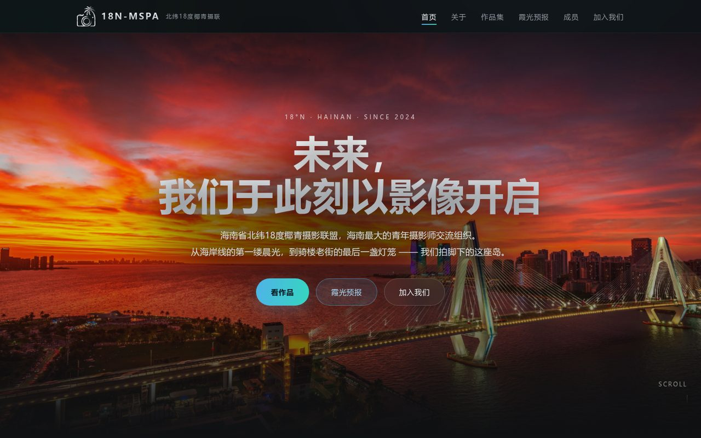
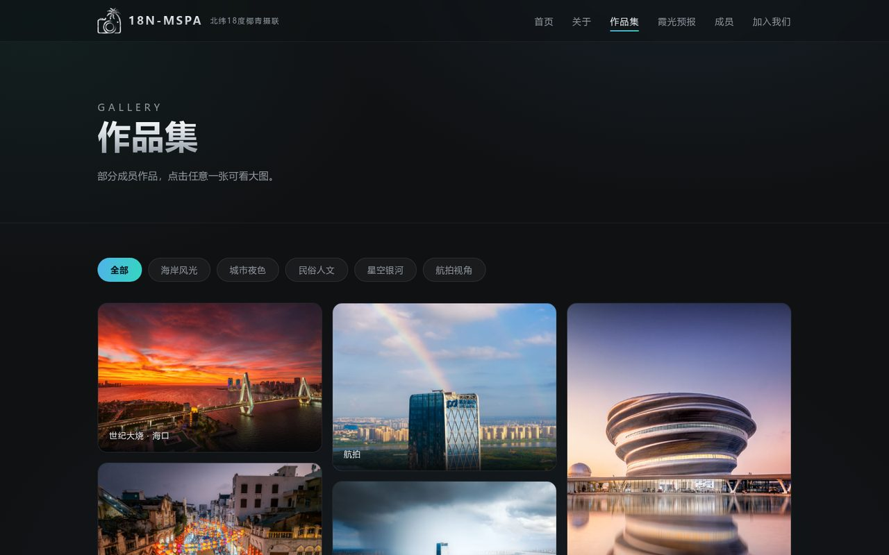
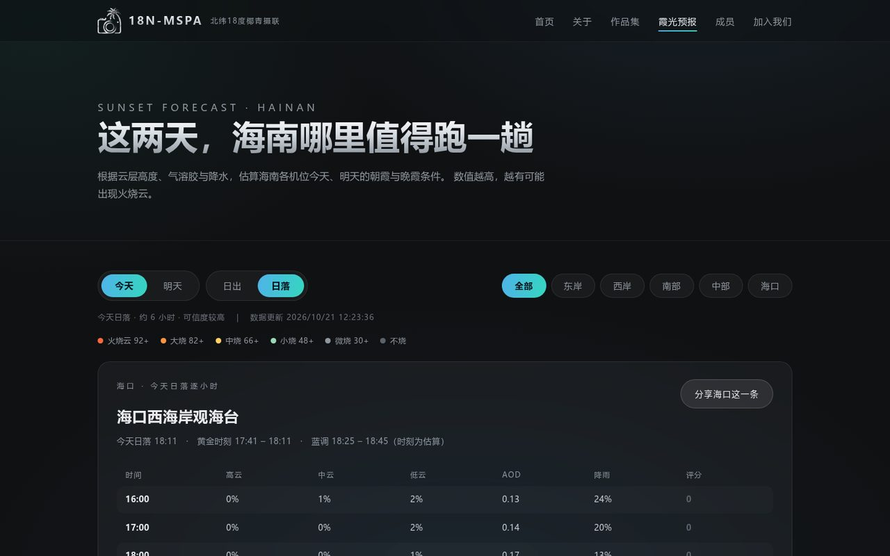
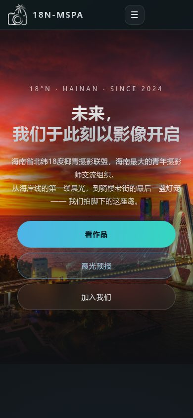

# 北纬18度椰青摄联 · 18N-MSPA

<p>
  <a href="https://hainan-n-mspa.netlify.app/"></a>
  <a href="#技术栈"></a>
  <a href="#技术栈"></a>
  <a href="LICENSE"></a>
  <a href="#版权与许可"></a>
</p>

> 海南省北纬18度椰青摄影联盟（18° North – Hainan Mass Student / Senior Photographers Association）
> 的官方网站。我们用影像记录此刻，开启未来。

**在线访问：[hainan-n-mspa.netlify.app](https://hainan-n-mspa.netlify.app/)** ·
[作品集](https://hainan-n-mspa.netlify.app/gallery) ·
[霞光预报](https://hainan-n-mspa.netlify.app/forecast) ·
[加入我们](https://hainan-n-mspa.netlify.app/join)

> **部署状态**：下面的截图来自本仓库当前版本；线上站点可能还停留在此前的一次部署
> （例如首页文案、预报页的日期 / 时段切换等细节以实际部署为准）。以仓库为准运行
> `python3 -m http.server` 看到的就是本文描述的样子。



## 关于这个项目

这是一个属于海南青年摄影爱好者的网站。成员以海南为主，也有散落在北京、上海、广州、深圳、香港、西安、重庆、长沙等地的伙伴。站点记录社团、成员与作品，也顺手做了一个认真到有点过分的「霞光预报」。

整个站点是**纯静态前端**：HTML + CSS + 原生 JavaScript，没有框架、没有构建步骤、没有自建后端、没有第三方 JS 依赖。改完文件刷新即生效，部署时把整个文件夹传上去就行。

| 作品集 | 霞光预报 |
| :---: | :---: |
|  |  |

## 页面

| 页面 | 地址 | 内容 |
| --- | --- | --- |
| 首页 | [`index.html`](index.html) | 社团简介、精选作品、预报入口 |
| 关于 | [`about.html`](about.html) | 名字的由来、我们在做什么、鸣谢 |
| 作品集 | [`gallery.html`](gallery.html) | 瀑布流作品墙、分类筛选、灯箱 |
| 霞光预报 | [`forecast.html`](forecast.html) | 25 个海南机位的朝霞 / 晚霞评分 |
| 成员 | [`members.html`](members.html) | 成员名录 |
| 加入我们 | [`join.html`](join.html) | 入群方式、公众号投稿细则 |
| 404 | [`404.html`](404.html) | 自定义错误页 |

## 功能

### 作品集

- 当前收录 **40 张**成员作品：`航拍视角` 11、`民俗人文` 3、`星空银河` 2、`城市夜色` 1、`海岸风光` 1，其余 22 张暂未分类（只在「全部」里出现）。
- CSS 多列瀑布流；作品墙只加载 `images/thumbs/` 里长边 ≤ 800px 的缩略图，点开灯箱才载入 `images/` 里的大图（多数长边 ≤ 1800px，首屏那张 2200×1468）。
- 图片懒加载，缩略图缺失时自动回退到大图，再缺才显示占位，不会整块空白。
- 分类筛选；支持 `gallery.html?cat=海岸风光` 这样的深链，可从站外直接落到某个分类。
- 灯箱支持点击遮罩、右上角按钮或 `Esc` 关闭，并显示作品标题。

### 霞光预报

这是全站最特别的部分：根据云层高度、气溶胶和降水，估算海南各机位今天 / 明天的朝霞与晚霞条件。

- **25 个机位**：按站点分区为 海口 10（含澄迈盈滨半岛，其中海口市区 9 个）、东岸 6、西岸 4、南部 4、中部 1；海口片区既有西向晚霞机位，也有桂林洋、东寨港这类东向朝霞机位。
- **4 种组合**：今天 / 明天 × 日出 / 日落；默认自动落到最近一个还没到的时段。数据一次加载后缓存在页面内存 10 分钟，期间切换组合、区域不会重新请求，刷新页面才会。
- **评分模型**：高云 × 低云 × 中云 × AOD（气溶胶光学厚度）× 降水/湿度，整体做 1.8 次方压缩；再用太阳方位角判断机位朝向是否对得上，按目标时刻前后各一小时做平滑，叠加高空湿度剖面与「明天」时效折扣。
- **等级**：火烧云 92+ / 大烧 82+ / 中烧 66+ / 小烧 48+ / 微烧 30+ / 不烧。
- **细节**：按区域筛选、逐小时详情面板、彩虹提示、朝向不符提示、剩余时间与可信度提示。
- **分享**：每一条都能一键复制带参数的链接和文案，发群里直接打开同一个机位。
- **回填**：点「✎」记录实际烧到什么程度，用于日后校准算法。走 Netlify Forms；如果线上表单没开通，会自动把反馈文本复制到剪贴板，不会让人白填。
- **数据源**：[Open-Meteo](https://open-meteo.com/) 的天气 API 与空气质量 API（CAMS AOD），共 3 个请求并行，免费、无需 Key。每个请求 15 秒超时并重试一次；AOD 取不到时退回默认值，不影响主功能。
- 页面内附有算法说明、参考文献和局限声明。**评分仅作摄影参考，不构成天气预报。**

### 站点细节

- 深炭灰 + 磨砂玻璃 + 银色渐变 + 青蓝强调色的视觉体系，样式变量集中在 `assets/style.css` 顶部。
- 响应式布局，手机端下拉菜单点完自动收起；触屏设备上作品标题常显。
- 滚动淡入、首屏极慢推近等动效均遵守 `prefers-reduced-motion`；关闭 JavaScript 时页面文案不会整块消失，但作品墙与霞光预报仍依赖 JS 渲染。
- 当前页导航高亮（同时写入 `aria-current`）；SEO 包含 `canonical`、Open Graph、Twitter Card、JSON-LD 结构化数据、`robots.txt`、`sitemap.xml` 和完整站点图标。

<p>
  
</p>

## 技术栈

| 层 | 选型 |
| --- | --- |
| 页面 | 原生 HTML5，6 个主页面 + 404 |
| 样式 | 原生 CSS（自定义属性、Grid / 多列、渐变、`backdrop-filter`、媒体查询） |
| 交互 | 原生 JavaScript（ES5 IIFE，无框架、无打包器、无 npm 依赖） |
| 数据 | Open-Meteo Weather API + Air Quality API，浏览器端直接取数、评分 |
| 图片 | 作品长边多 ≤ 1800px（首屏图 2200×1468）/ 缩略图 ≤ 800px；PowerShell + `System.Drawing` 批处理 |
| 托管 | Netlify 静态托管；`_headers` 控制缓存；Netlify Forms 收集反馈 |
| SEO | canonical / OG / Twitter Card / JSON-LD / robots / sitemap |

没有 `package.json`，没有 `node_modules`，没有构建产物。

## 本地运行

克隆或下载本仓库后，在仓库根目录起一个静态服务器即可：

```bash
# Python 3 自带，任意系统可用
python3 -m http.server 8000
```

然后打开 <http://localhost:8000>。

> **不建议用 `file://` 直接双击打开。** 霞光预报要从 Open-Meteo 取数、反馈要走表单提交，浏览器对本地文件有跨域与表单限制，双击打开可能取不到数据；用上面的 HTTP 服务器最稳妥。部署上线后不存在这个问题。

## 目录结构

```text
.
├── index.html                # 首页
├── about.html                # 关于
├── gallery.html              # 作品集
├── forecast.html             # 霞光预报
├── members.html              # 成员
├── join.html                 # 加入我们 / 投稿指南
├── 404.html                  # 自定义错误页
├── assets/
│   ├── style.css             # 全站样式与设计变量
│   ├── main.js               # 导航、滚动淡入、作品墙、灯箱
│   ├── photos.js             # 作品清单（加图改这里）
│   ├── forecast.js           # 机位库 SPOTS 与评分算法
│   └── logo-mark.svg         # 相机 + 椰树标记（SVG 源文件）
├── images/                   # 网站用图
│   ├── thumbs/               # 作品墙缩略图（工具自动生成）
│   └── readme/               # 本 README 的截图
├── tools/
│   ├── optimize-images.ps1   # 批量压缩 + 生成缩略图
│   └── make-favicon.ps1      # 从 logo 生成站点图标
├── 1-把图片文件夹拖到我身上.bat  # 把新照片复制进 images/
├── 1-准备图片-把压缩文件夹拖到我身上.bat  # 已停用，仅提示改用上一行
├── 2-生成网站图标.bat        # 生成 favicon / apple-touch-icon
├── 3-压缩新图片.bat          # 压缩 + 生成缩略图
├── 使用说明.md               # 面向社团维护者的中文操作说明
├── README.md
├── .gitignore                # 忽略原图、RAW、系统临时文件
├── _headers                  # Netlify 响应头与缓存策略
├── robots.txt
├── sitemap.xml
└── LICENSE                   # GPL-2.0（仅覆盖代码）
```

以上只列主要文件。未压缩的原图不会进仓库：`.gitignore` 会忽略 `raw/`、`原始/`、`椰青/` 等目录以及 PSD / RAW 文件。网站只使用压缩后的图片，仓库体积约 15 MB（其中作品 40 张大图约 11 MB，缩略图约 2.4 MB）。

## 内容维护

### 添加作品

1. 把照片放进 `images/`。长边建议不超过 1800px，格式 JPEG。
2. 生成缩略图：
   - Windows：双击 **`3-压缩新图片.bat`**。脚本会对 `images/` 里大于 700KB 的图重新压缩（长边 1800px），并为每张 `.jpg` 在 `images/thumbs/` 生成 800px 缩略图，自动按 EXIF 方向摆正。可以重复运行，但每次都会重建全部缩略图；它不区分作品和素材图，别把不需要的 jpg 放在 `images/` 根目录。
   - macOS / Linux：用任意图片工具按同样规格导出，或直接放图后手动补 `images/thumbs/` 同名缩略图。
3. 在 [`assets/photos.js`](assets/photos.js) 的 `window.PHOTOS` 里加一行：

```js
{ f: "文件名.jpg", t: "标题", c: "海岸风光", a: "作者" },
```

- `f`：文件名，必须和 `images/` 里完全一致（含空格、中文、括号）。
- `t`：标题，留空则显示默认文案。
- `c`：分类，只能是 `海岸风光` / `城市夜色` / `民俗人文` / `星空银河` / `航拍视角`；留空表示暂未分类。
- `a`：作者，留空不显示。

### 添加预报机位

编辑 [`assets/forecast.js`](assets/forecast.js) 顶部的 `SPOTS` 数组：

```js
{ n: "机位名", lat: 20.026, lon: 110.285, face: "西", area: "海口" },
```

`face` 可选：`东` / `东南` / `南` / `西南` / `西` / `西北` / `北` / `山顶`。
`area` 可选：`海口` / `东岸` / `西岸` / `南部` / `中部`。

### 修改文案与样式

- 页面结构：直接改对应的 `.html`。
- 全站配色、字号、间距：改 `assets/style.css` 顶部的 CSS 变量。
- 交互逻辑：`assets/main.js`；预报算法：`assets/forecast.js`。

改完不需要构建，刷新浏览器即可。保持「纯静态、零依赖」是这个项目的有意选择。

## 部署

当前线上版本部署在 **Netlify**，方式是拖拽上传，不需要构建命令：

1. 打开 <https://app.netlify.com/drop>。
2. 把整个仓库文件夹拖进页面（不是拖单个文件）。
3. 等待上传完成，刷新即可看到新版。

> 域名只有在该站点已登录并「认领」（Claim）的前提下才会保持不变。如果匿名拖拽，Netlify 会生成一个新的随机域名，之前发出去的链接都会失效——所以请用社团自己的 Netlify 账号登录后再拖，并记得先删掉本地的临时目录、压缩包等不该上传的文件。

如果 Fork 后部署到自己的域名 / 平台，请记得同步替换以下位置的网址：

- 各页面的 `<link rel="canonical">`、`og:url`、`og:image`、JSON-LD；
- `robots.txt` 的 `Sitemap` 地址；
- `sitemap.xml` 里的所有 `<loc>`。

两个平台特性只对 Netlify 生效：

- `_headers`：`/images/*` 缓存 7 天、`/assets/*` 缓存 1 天，另附 `X-Frame-Options`、`X-Content-Type-Options`、`Referrer-Policy`；迁到其他静态托管需在平台侧自行配置。
- Netlify Forms：反馈表单名为 `sunset-feedback`。需要在 Netlify 后台开启 Form detection 并重新部署一次，表单才会被识别；未开通时前端会退化为「复制反馈文本」。
- 站内链接使用构建无关的无扩展名写法（如 `/gallery`），依赖 Netlify 的 pretty URL；若迁到 GitHub Pages 等需要显式 `.html` 的托管，链接、sitemap 与 canonical 都要相应调整。

## 版权与许可

**代码**采用 [GNU General Public License v2.0](LICENSE)。你可以自由使用、修改、再分发；如果对外发布修改后的版本，需要同样以 GPL-2.0 开放源代码。这里的「代码」指 HTML、CSS、JavaScript，以及 `tools/` 下的 PowerShell 脚本和根目录的 `.bat` 脚本。

**照片、社团标识与二维码不在 GPL 范围内，版权归各摄影师与 18N-MSPA 所有，保留所有权利。** 这包括：

- `images/` 下的全部摄影作品与图片素材（含 `images/thumbs/`、分享封面和 README 截图中的作品）；
- `images/mspa透明底.png`、`images/nmspa.png`、`assets/logo-mark.svg` 等社团标识；
- `images/二维码.jpg` 及公众号相关素材。

Fork 代码没有问题，但**请不要把站内照片与标识用于其他项目**。需要转载、商用或取得照片授权，请通过公众号「北纬18度椰青摄联」联系我们。

## 致谢

- 天气与空气质量数据：[Open-Meteo](https://open-meteo.com/)（含 CAMS 再分析 / 预报数据）。
- 霞光评分的思路与参数参考了 [SunsetBot 团队](https://www.sunsetbot.top/) 的公开教程、CMA-BJ 云量预报检验论文、WMO 国际云图与 NOAA 太阳位置算法，完整文献列表见霞光预报页底部。
- 一路同行的伙伴：海南高校摄影联盟、北京风光摄影联盟、寰宇追光部落、海口四中森蓝摄影社、海南侨中摄氏度摄影社，以及 yms、ted 倾斜的地平线。
- 以及每一位在凌晨三点起床追光、把作品交给我们的成员。

## 联系与参与

- 微信公众号：**北纬18度椰青摄联**；私信「我要加入」获取审核员微信，添加时备注「椰青摄影入群」可更快通过。投稿也可私信群主 / 管理员说明主题，或留意群里发布的征稿消息。
- 入群与投稿细则：[join.html](join.html)。
- 代码问题、文案纠错、机位补充，欢迎提 Issue 或 Pull Request。提交照片前请确认你拥有该作品的版权或授权，并先按上面的流程压缩图片。

---

<sub>本站霞光评分仅作摄影参考，不构成天气预报；请以官方气象台发布为准。</sub>

© 2026 北纬18度椰青摄联 18N-MSPA · 海南省海口市
# hainan-n-mspa
