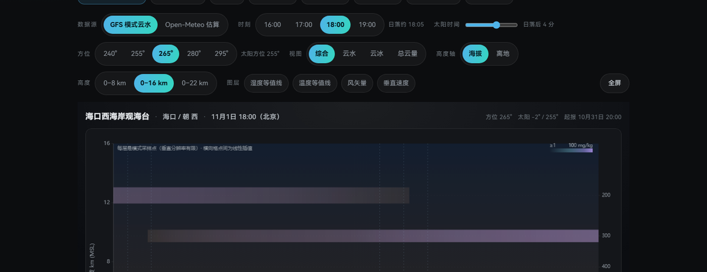
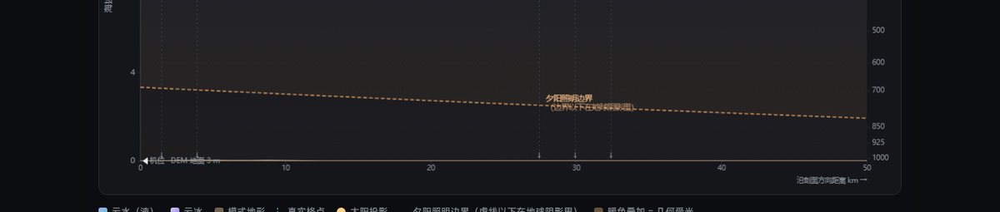

# 阶段七-01 · 太阳几何与照明引擎（`/cross` P1）实现报告

日期：2026-11-01　对应任务书：§三 3.2 / 3.3 / 3.4 / 3.5、§八 数据真实性、§十一 P1

> 本阶段只做一件事：把「太阳能不能照到这段云、什么时候照到、什么时候失去、光路被谁挡住」
> 变成**可核对的计算 + 可读的界面**。
> 不做辐射传输，不预测火烧云，不改变 `scoreOf()` 与 `data/forecast/`。

---

## 1. 修改文件清单

| 文件 | 性质 | 说明 |
|---|---|---|
| `tools/xsec/build_context.py` | 新增 | 构建环境上下文缓存：真实 DEM 地形序列 + AOD（独立于 GFS 剖面） |
| `data/cross/context.json` | 新增（生成物） | 8 个试点机位：DEM 剖面（5 方位 × 41 点）、太阳方位地形（4 时次 × 61 点）、逐时 AOD；13.3 KB |
| `src/lib/xsec/light.ts` | 新增 | 光照几何引擎：曲率、阴影边界、受光判据、日落线、大气质量、透过率、地形视线/遮挡、逐云带受光窗口 |
| `src/lib/xsec/types.ts` | 修改 | 新增 `XsecContext` / `XsecSpotContext` / `XsecDemSeries` 等类型（只增不改旧字段） |
| `src/lib/xsec/api.ts` | 修改 | 新增 `loadXsecContext()`（缺失时页面降级，不影响云场） |
| `src/components/xsec/CrossSectionChart.vue` | 修改 | 地形改用真实 DEM；画夕阳照明边界与地球阴影区；受光云体加暖色；太阳光线按 AOD 变暗；tooltip 增加光照几何一行 |
| `src/pages/CrossSectionPage.vue` | 修改 | 新增「太阳时间」滑杆、太阳与照明几何卡、图例与数据来源说明；URL 支持 `sun=`（太阳相对日落的分钟） |
| `src/styles/pages/cross.css` | 修改 | 新卡片/图例/滑杆样式 |
| `tools/xsec/test-light.mjs` | 新增 | 52 项光照几何数值回归（esbuild 直接打包 `light.ts`，不抄第二遍公式） |
| `.github/workflows/xsec-cache.yml` | 修改 | 新增「构建环境上下文」步骤（`continue-on-error`，失败不阻塞 GFS 缓存） |
| `tools/todo.mjs` | 修改 | 台账：太阳几何卡关闭，新登记「远场光路视野」 |

**没有改**：`scoreOf()` / `src/lib/forecast/scoring.ts` / `src/lib/forecast/sun.ts` / `data/forecast/` / `tools/xsec/build_cross.py` / 已发布的 8 机位 GFS 剖面数据。

---

## 2. 数据源与变量清单

| 量 | 来源 | 分辨率 / 精度 | 本产品怎么用 | 缺测怎么办 |
|---|---|---|---|---|
| 地形高程 | **主源** Open-Meteo Elevation API（Copernicus DEM GLO‑30）；**备源** OpenTopoData SRTM 90 m | DEM 30 m / 90 m 原始网格，本产品**每 1.25 km 取 1 点**（0–50 km 共 41 点）；太阳方位每 2.5 km（0–150 km 共 61 点） | 图底部地形轮廓、机位海拔、地形视线角、光路遮挡 | 整段标注「DEM 缺测」，退回 GFS 模式地形（平滑值）并明说 |
| AOD（550 nm 柱总量） | Open-Meteo Air Quality API（CAMS global） | 0.25° 级、逐小时；无量纲 | `exp(−AOD·m)` 直射削弱、太阳光线明暗、卡片透过率 | 不透率、卡片写「缺测」，不用 0.2 之类的默认值冒充 |
| 太阳位置 | 现有 `src/lib/forecast/sun.ts`（NOAA 低精度） | ±0.01° 量级，逐分钟可算 | 方位/高度角/剖面内投影/日落时刻 | — |
| 云水/云冰/云量/RH/风/ω/位势高度 | 已有 GFS 0.25° 剖面缓存 | 0.25° 水平、9 个气压层 | 判「哪一层有云」 | 缺测不参与判断（不当 0） |

**本轮实测到的数据源限制（必须写进文档，避免以后误判）**：
Open-Meteo 免费额度在同一出口 IP 上会按小时封顶，返回
`429 {"error":true,"reason":"Hourly API request limit exceeded"}`。
因此 `build_context.py` 做成：主源失败 → 自动回退 SRTM 90 m，并把**每个机位实际使用的 DEM 来源**写入
`demSource`，页面图例与数据表显示的就是真实来源（截图里是 `SRTM 90m（OpenTopoData，Open-Meteo 限额回退）`）。
—— 这不是"随便换个源"，来源差异被明确标注，且 DEM 精度差异（30 m vs 90 m）对 1.25 km 取样几乎无影响。

---

## 3. 计算公式与物理假设

符号：`R = 6371.0088 km`；`el` = 机位处太阳高度角（°）；`l` = 沿剖面方位的水平距离（km）；
`Δ` = 太阳方位 − 剖面方位；`dSun = l·cosΔ`（沿太阳方位的分距离，向太阳为正）；`h` = 海拔（m）。

| # | 量 | 公式 | 单位 | 条件 / 假设 | 来源 / 验证 |
|---|---|---|---|---|---|
| 1 | 视地平俯角 | `dip(h) = arccos(R/(R+h))` | ° | 球形地球，无折射 | 球面几何；`dip(2000 m)=1.426°` 单测 |
| 2 | 当地太阳高度角 | `el_local = el + dSun/R` | ° | 太阳视为无穷远；忽略折射 | 球面几何；与阶段六-03 的 `atan(h/d) − d/(2R)` 同源 |
| 3 | 受光判据 | `el_local > −dip(h)` | — | 直射光不被地球挡住 | 与原文 image76/86 的 `h=(l−vt)²/(2R)` 在 `el=0` 时同形（单测 5 个距离 × 2 侧） |
| 4 | 阴影边界高度 | `u = el + l·cosΔ/R`；`u<0` 时 `h_b = R·u²/2`，否则 0 | km | 同上 | 与 #3 互为充要（单测用"略高/略低于边界"双向验证） |
| 5 | 地面日落线位置 | `l_0 = −R·el/cosΔ` | km | `|cosΔ|<0.15` 时不可判 → null | 数值验证：`el=−1°` → 111.2 km |
| 6 | 边界移动速度 | 两次太阳位置（相隔 10 min）求 `l_0` 差分 | km/min | 沿剖面方向的速度，**不是**原文附录表口径 | 单测 25.5 km/min（海南 11 月，与 `ωR·cosφ≈26` 同量级） |
| 7 | 大气质量 | `m = 1/(sin el + 0.50572·(el+6.07995)^−1.6364)`，封顶 38、下限 1 | 无量纲 | Kasten–Young 近似 | 与 `scoring.ts` 同一式子（只读引用，未改评分） |
| 8 | 直射透过率 | `T = exp(−AOD·m)` | 0–1 | Beer–Lambert **单次散射**；不含多次散射、水汽、臭氧、波长依赖 | 单测 `AOD=0.2, el=90° → 0.819` |
| 9 | 地形视线角 | `max_i [atan2(Δh_i, d_i) − d_i/(2R)]` | ° | 沿某方位的 DEM 序列；忽略横向地形 | 原文 image136 公式 |
| 10 | 光路被地形挡 | `h_ray(x) = h + (x−d)·tan(el_local) + (x−d)²/(2R)`，若地形高于光路则挡 | — | 二维近似（只沿太阳方位的地形） | 单测：3 km 山脊 / 0° 挡、6° 不挡 |
| 11 | 逐云带受光窗口 | 在日落 ±(60/90) min 内以 15 s 步长扫 `el(t)`，找 `litAt()` 跳变 | min | 云底取最低点（最早失光的一侧）；云水平位置取路径中点投影 | 单测：2 km 头顶 ~2–7 min 失光、8 km 更久、向阳侧 > 头顶 > 背阳侧 |

**必须明说的假设与局限**：
1. 太阳位置不含大气折射（真实折射会把视高度抬高约 0.5°，本项目统一用 `el < −0.833°` 判日落，与预报页一致）。
2. 二维剖面只能表达太阳方位接近剖面方位时的光路；`Δ` 大时用 `cosΔ` 投影，垂直剖面的分量画不出来——界面会写"太阳不在剖面平面内"。
3. 地形遮挡是**二维近似**（沿太阳方位 0–150 km 的 DEM 序列），不是三维地形求交。
4. 透过率只解释"直射光被削弱多少"，不解释"天空看起来多亮"；`el` 贴近 0 时数值会低到 <1%，真实亮度很大部分来自多次散射。
5. 「几何受光」≠「云会烧」。云量、厚度、液/冰、气溶胶谱、观测方向都不在本阶段计算范围内。

---

## 4. 已实现功能

**数据层**
- `context.json`：8 机位 × 5 剖面方位 × 41 点 DEM；× 4 时次太阳方位 × 61 点 DEM；× 4 时次 AOD。13.3 KB，与 GFS 剖面缓存完全解耦。
- CI 每次更新缓存时重建（失败不阻塞 GFS 缓存提交）。

**引擎层**（`src/lib/xsec/light.ts`，纯函数、无 DOM）
- 见上表 #1–#11；全部带公式、单位、条件、局限注释。

**界面层**
1. **夕阳照明边界**：图上橙色虚线，边界以下填充为地球阴影；位置随太阳时间移动。
2. **受光云体暖色叠加**：几何受光处加一层很淡的暖色（图例明示"暖色叠加 = 几何受光"），不改变云变量颜色。
3. **真实 DEM 地形**：图底部轮廓改为 DEM（41 点），图例标注实际来源；DEM 缺测才退回模式地形。
4. **太阳光线按 AOD 变暗**：透过率越低光线越淡，太阳旁标注「直射透过率 X%」。
5. **「太阳时间」滑杆**：相对日落 −20…+20 分钟，逐分钟移动太阳与照明边界；**云场不动**，并明确写"太阳位置按分钟计算，云场仍取所选时次"。
6. **「太阳与照明几何」卡**：此刻太阳（高度角/方位/方位差/剖面内投影）、距日落、地形视线（剖面方向 vs 太阳方向）、AOD 与透过率、日落线位置与移动速度、阴影上缘高度、逐云带受光/失光时刻与时长（含北京时间）、是否被地形遮挡。
7. **tooltip** 增加「光照几何：在太阳直射光中 / 在地球阴影内」。
8. **URL 可分享**：`?spot=&t=&az=&sun=`，`sun` = 太阳相对日落的分钟数。

---

## 5. 未实现功能及原因

| 未做 | 原因 | 下一步 |
|---|---|---|
| 400 km / 远场视野 | 现有剖面只有 0–50 km，而照明边界常在数十到数百 km 外；要改 GFS 采样几何（多采样点/更长路径）并重建缓存 | 台账 `cross-far-field-sunpath`（P3） |
| 云体「受光时长」按云顶/云底分别给 | 目前按云底（最早失光）给单值，避免给出一个看着精确、其实依赖层厚假设的区间 | 与云厚不确定度一起做 |
| 摄影价值卡（归因） | 需要把受光、云量、厚度、AOD 合成一句可读结论；要先把「经验阈值」与「几何结论」分开 | 阶段 E |
| 露点/RH 诊断云的「潜在云区」与几何云体 | 任务书 P2；当前仍是 GFS 云水/云冰逐层细带 | 阶段 P2 |
| 降水圆点 / 彩虹几何 | 任务书 P4；需要降水变量与观测者—太阳—雨幕三维关系 | 阶段 P4 |
| 224 机位 | 见 §9 | 阶段 P6 |

---

## 6. 测试结果

```
node tools/xsec/test-light.mjs        → 52 项全部通过
node tools/litgeo/verify.mjs          → 76 项全部通过（阶段六公式复核，未改）
node tools/test-boundaries.mjs        → 32 项全部通过
node tools/test-physics.mjs           → 23 项全部通过
node tools/test-cache-format.mjs      → 缓存格式与前端读取全部正常
python tools/xsec/verify_cross.py     → 8 机位 / 160 剖面 / 341.4 KB，校验通过
node node_modules/vue-tsc/bin/vue-tsc.js --noEmit → 0 error
```

`test-light.mjs` 覆盖：俯角/曲率、与原文 `h=l²/(2R)` 的一致性（背阳侧 5 个距离）、受光判据与边界曲线互证（5 组参数双向）、日落线位置/投影/不可判、边界速度、Kasten–Young 大气质量、Beer–Lambert 透过率、地形视线、光路遮挡（挡/不挡/缺测）、逐云带受光窗口（头顶/向阳/背阳/高云对比）、中文时间描述。

**用真实缓存做的交叉核对**（`hk-xihai`，2026-11-01 19:00 北京 = 日落后 55 分）：
`el = −13.5°`，太阳方位 259°/剖面 265°，地面日落线在前方 1514 km，`0 km` 处阴影上缘 178 km；
云底 2 km 的云在日落后 3.25 min 失去直射光，8 km 高的云 9.5 min——符合"越高越晚失光"。

---

## 7. 实际页面截图

`shot` 站点：本地 `dist`（`npm run build` 产物），Edge headless 1440×2900。





截图参数：`/cross.html?spot=hk-xihai&t=2&az=265&sun=4`（GFS 18:00 时次 + 太阳时间挪到日落 +4 分）。
可见：橙色虚线「夕阳照明边界」贴着地面向右抬升，边界下方为地球阴影；卡片给出日落线 210 km（前方）、0 km 处阴影上缘 3.3 km、边界移动 25.6 km/min、AOD 0.16 → 透过率 <1%（太阳已在地平线下）。

---

## 8. 数据精度与分辨率说明

- **DEM 采样 1.25 km / 2.5 km**：远粗于 DEM 原始 30 m/90 m，图上地形是"每 1.25 km 一个高程点连成的轮廓"，不是 30 m 精度地形。
- **地形遮挡**只沿太阳方位一条线取地形，横向山谷/山脊会漏判。
- **AOD** 是 0.25° 级柱总量，没有垂直分布；用它算 `exp(−τ·m)` 会把整层气溶胶当成均匀分布。
- **太阳位置** NOAA 低精度，±0.01°；无折射。
- **云场** 仍是 0.25°／9 层的 GFS 预报，不是观测；层间以细带表达，厚度只能精确到模式层距。
- 受光判据的**边界时间**由 15 s 步长扫描得到，误差 ≤15 s；但云底高度本身的不确定度（模式层距 ~0.5–2.5 km）远大于它。

---

## 9. 全国 224 机位适配情况

- 本阶段**没有**扩大机位数量：仍是 8 个试点机位（海口西海岸、澄迈盈滨、临高角、昌江棋子湾、东方鱼鳞洲、乐东龙沐湾、三亚天涯海角、五指山主峰）。
- 但所有新代码都是**机位无关**的：`context.json` 按机位 id 组织，`build_context.py` 只读 `data/cross/index.json` 的机位列表；DEM 采样用机位经纬度 + 方位角，不含任何海南特判。
- 全国 224 的阻塞项没有变：**224 个机位仍全部缺少海拔字段**，且 224 × 5 方位的地形采样会产生约 224 × 6 ≈ 1300 次高程请求（按 Open-Meteo 30 次/分钟的安全速率约 45 分钟）。
  建议全国首版：海拔用 `context.json` 同一套流程批量补齐（`--spots` 支持分批），先补 14 个分区验证机位。
- 已登记台账：`cross-224-national`（未开工）。

---

## 10. 性能与缓存情况

| 项 | 数值 |
|---|---|
| `data/cross/context.json` | 13.3 KB（8 机位），全部机位 5 方位约 0.37 MB 估算 |
| 生成请求数 | 8 机位 × (3 段地形 + 3 段太阳方位地形 + 1 次 AOD) ≈ 56 次；实测单机位 16–25 s（OpenTopoData 1.3 s/请求） |
| CI 增量 | 新增一步 `build_context.py`，`continue-on-error`；不改变 GFS 剖面缓存提交逻辑 |
| 前端 | `context.json` 与剖面文件并行加载；光照计算是纯函数，单次页面交互（滑杆/悬停）<1 ms 量级；canvas 重绘 820×430，无新增网络请求 |
| 兼容性 | 未改 `scoreOf()` / `scoring.ts` / `data/forecast/`；`/forecast` 页面零改动；Cloudflare Pages 部署方式不变 |

---

## 11. 验收对照（任务书 §十二 A 专业性 1–12）

| # | 条目 | 状态 |
|---|---|---|
| 1 | 太阳位置与预测时刻对应 | ✅ 逐时次 + 分钟级滑杆，`sunPosition()` 同一实现 |
| 2 | 光路计算符合几何关系 | ✅ 球面几何，52 项单测 + 与原文公式一致性检验 |
| 3 | AOD 削光使用真实可追溯数据 | ✅ CAMS AOD + 来源/时次写进卡片；缺测不编造 |
| 4 | RH 潜在云区诊断有明确依据 | ⏳ 未做（仍是 GFS 云水/云冰；RH 只作辅助等值线） |
| 5 | 云水/云冰/总云量区分 | ✅ 沿用阶段七 v2 的四模式，未混用 |
| 6 | 照明边界有明确数学定义 | ✅ §3 #4，含 `el=0` 与原文公式一致性验证 |
| 7 | 云体受光起止时间可计算 | ✅ 逐带给出（云底口径），含北京时间 |
| 8 | 降水区域使用真实变量 | ⏳ 阶段 P4 |
| 9 | 彩虹判断考虑空间几何 | ⏳ 阶段 P4 |
| 10 | 地形数据有明确来源 | ✅ DEM（Copernicus / SRTM 回退）+ 每个机位 demSource |
| 11 | 原生分辨率正确展示 | ✅ 卡片与数据表写清 0.25°/9 层/1.25 km 采样 |
| 12 | 缺测与不确定性正确处理 | ✅ 缺测 = null，不用 0/默认值；地形缺测退回模式地形并标注 |

---

## 12. 下一步（按优先级）

1. **远场光路视野**（P3）：把剖面采样几何扩到 ~400 km（9→更多采样点）或在主图下加"光路带"，让照明边界真正进入视野并随时间移动。
2. **摄影价值卡**：把"几何受光 + 云量/厚度 + AOD"合成可读结论，并明确写归因（为什么可能翻车）。
3. **RH 诊断潜在云区**（P2）：与 GFS 云水并列显示，明确"RH 诊断 ≠ 模式云水"。
4. **降水圆点 + 彩虹几何**（P4）。
5. **全国 224**（P6）：先补海拔 → 14 分区验证机位 → 3 时次 × 1 方位批量。
